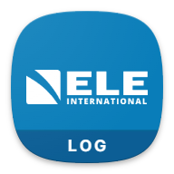

<p align="center"></p>

<h1 align="center">ADR PRO</h1>

<p align="center">ELE ADR Touch PRO log merger for Android. Pull one cell from every CSV test log and merge the values into a single file.</p>

## What it does

- Pick a folder, several CSV files, or the machine TEST root (USB drive or storage) and merge a whole date folder in one tap.
- Reads one cell from each file. The default is `B9`, and you can change it in the cell settings.
- Shows the extracted values in a table. Tap a row to inspect the first rows of the source file with the target cell highlighted.
- Saves a merge history on the device so you can reopen or delete earlier batches.
- Saves the merged CSV (also auto-saved to `Documents/ADR LOG`), or shares it to other apps.
- English and Arabic interface.

## Build

Android Studio or Gradle with JDK 17:

```
gradle assembleDebug
```

Package: `com.ELE.ADR.Merger`. Kotlin, Jetpack Compose, Room.

## Download

Get the APK from the [Releases](../../releases) page.

## Source recovery

The original project only existed as an APK. The source here was rebuilt from it. The decompiled output and extracted resources are kept under [`recovery/`](recovery) for reference.

## License

MIT, see [LICENSE](LICENSE).

---

<p align="center">Brought to you by <b>Instinct</b></p>
